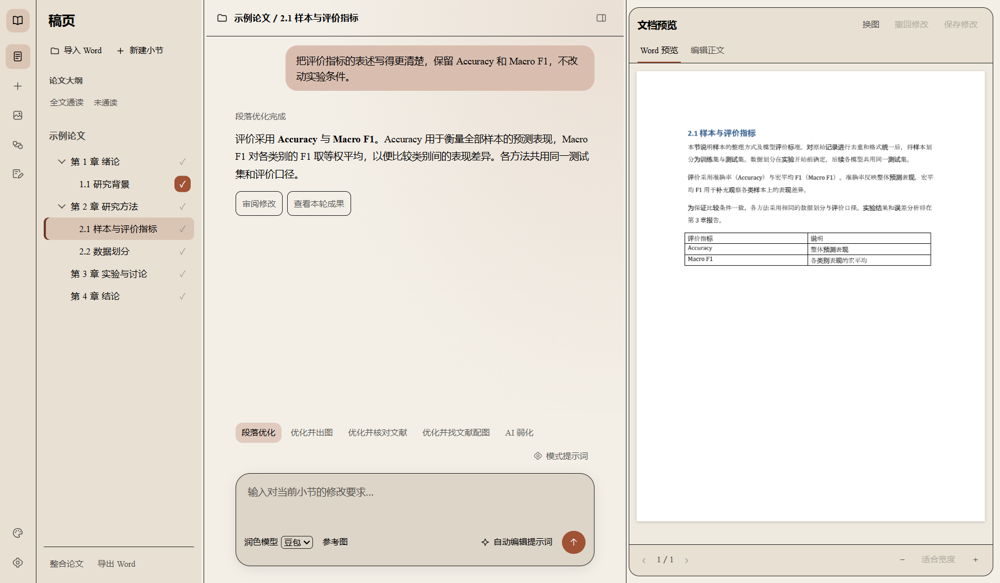

# 稿页

稿页是面向论文修订的 Windows 桌面应用。左侧按章管理小节，中间提交修改要求，右侧预览和编辑 Word 正文。



*稿页 Windows 界面，使用示例论文展示。*

## 使用流程

1. **导入 Word**。稿页按标题生成大纲，点击章节即可预览或编辑。
2. **提交修改**。选择润色、配图或文献核查模式，在中间输入本轮要求。
3. **审阅并导出**。对照原文和建议稿，按需采用正文或替换图片，再导出 Word。

## 功能

- 导入 Word 文档，折叠章节、标记定稿、预览整节。
- 通过豆包或 GPT 润色，并按任务类型接力生图、找图或核查文献。
- 在采用前对照正文、图片和来源。按需批改全文，支持撤回最近一批。
- 根据默认排版、文字要求或 Word／PDF 参考格式导出 Word。

## 运行源码

需要 Windows 10/11 x64、Python 3.12（含 Tkinter）和 Microsoft Edge WebView2。页式 Word 预览还需要本机安装 Microsoft Word。

在源码目录打开 PowerShell：

```powershell
py -3.12 -m venv .venv
.\.venv\Scripts\python.exe -m pip install -r requirements.txt
.\.venv\Scripts\python.exe -B paper_webview.py
```

在「模型设置」连接自己的 DeepSeek 或兼容接口，按需让稿页安装缺失的 Codex 和 CodeBuddy CLI，再用各自账号登录。使用豆包时，安装并登录豆包桌面端，将源码目录命名为「论文工作站」，并在豆包工作任务中选为本地工作区。

稿件和任务存放在程序目录下。提交 AI 任务后，所选服务会收到完成任务所需的材料。调度模型凭据保存在 Windows 凭据管理器中。

## 构建便携版

在源码目录运行：

```powershell
.\.venv\Scripts\python.exe -m pip install pyinstaller==6.22.3
.\.venv\Scripts\python.exe -m PyInstaller --noconfirm packaging/gaoye.spec
Copy-Item -Recurse -LiteralPath '提示词' -Destination 'dist/稿页/提示词'
```

将整个 `dist/稿页` 目录一起分发。使用豆包协作时，把分发后的应用目录命名为「论文工作站」。Codex、CodeBuddy、Node.js 及各模型服务由其各自的提供方发布。

## 许可

稿页源码按 [MIT 许可证](LICENSE) 发布。
