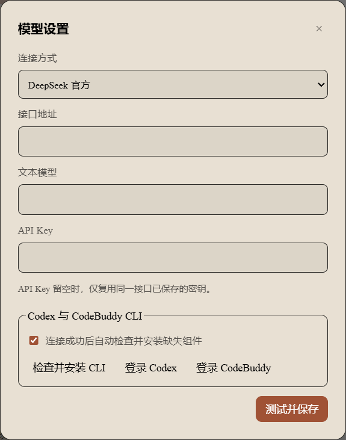
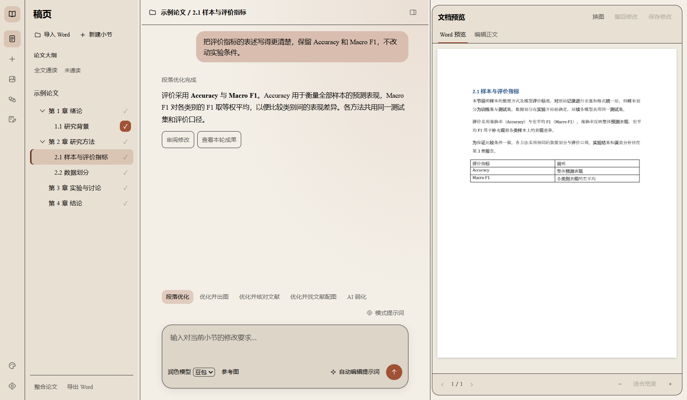
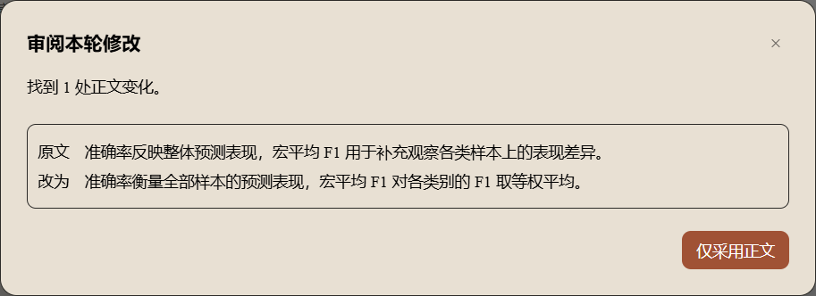
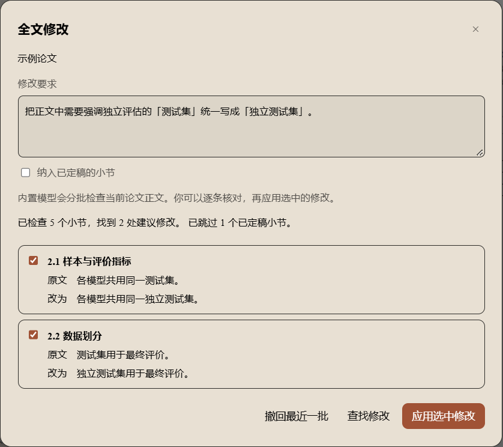
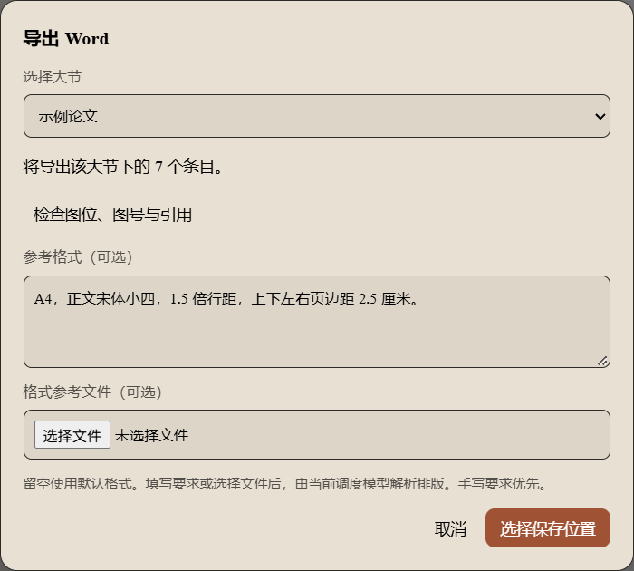

# 稿页使用说明书

稿页是 Windows 上的论文编辑工具。你可以导入已有 Word 论文，按章节修改，审阅每一轮的建议，最后导出 Word。以下截图用的是示例论文和模拟任务。

- [启动与连接模型](#1-启动与连接模型)
- [导入 Word 和管理章节](#2-导入-word-和管理章节)
- [提交任务与审阅修改](#3-提交任务与审阅修改)
- [修改全文与撤回批次](#4-修改全文与撤回批次)
- [检查并导出 Word](#5-检查并导出-word)
- [常见问题](#常见问题)

## 1. 启动与连接模型

使用源码版时，按 [仓库首页的启动步骤](../README.md#运行源码) 安装 Python 依赖并打开程序。Windows 需要 **Microsoft Edge WebView2**，分页预览还需要安装桌面版 **Microsoft Word**。如果拿到的是便携版，把整个文件夹解压到可以写入的位置，再打开「稿页.exe」。

1. 点左侧底部的齿轮打开「模型设置」。选择 **DeepSeek 官方**或 **OpenAI 兼容中转**，填入你的接口地址、模型名和 API Key，点「测试并保存」。
2. 勾选「连接成功后自动检查并安装缺失组件」时，稿页会联网安装缺失的 Codex 与 CodeBuddy CLI。也可以手动点「检查并安装 CLI」。
3. 用 GPT 润色、配图或查文献前，点「登录 Codex」并按提示操作。用 CodeBuddy 作调度模型时，先安装 CLI，再点「登录 CodeBuddy」，必要时在控制台输入 `/login`，登录后测试连接。
4. 选择豆包润色时，安装并登录豆包桌面端。打开豆包的工作任务，选择「本地电脑」，将包含稿页的「论文工作站」文件夹设为协作目录。左侧「协作工作区」可以打开这些目录及客户端。

## 2. 导入 Word 和管理章节

1. 点左上「导入 Word」，选择 `.docx`。原稿使用 Word 的「标题 1」「标题 2」等样式时，大纲层级更容易识别。
2. 点标题左边的箭头展开或收起子节。点大节可看「整节预览」，点小节可查看该节。右侧预览支持连续滚动，按住 **Ctrl** 滚动可缩放。
3. 点预览里可编辑的段落，或切到「编辑正文」直接修改。用「保存修改」或 **Ctrl+S** 随时保存，自动保存间隔为两分钟。
4. 双击大纲标题可改名，按 **Enter** 保存。右键菜单可以删除小节，点标题右侧的 **✓** 可标记为已定稿，再点一次可取消。

## 3. 提交任务与审阅修改

在中间输入框上方选模式，选择润色模型，输入本轮要求后发送。比如：`缩短第二段，保留样本数量、指标和引文编号。`

| 模式 | 适合什么时候用 |
| --- | --- |
| 段落优化 | 改语句、衔接或结构 |
| 优化并出图 | 根据正文生成示意图 |
| 优化并核对文献 | 查找证据并核对正文论述 |
| 优化并找文献配图 | 从参考文献定位原图并记录出处 |
| AI 弱化 | 减少重复和套话，保留原意 |

配图和核查任务会先收集成果，再让豆包据此微调相关正文。「查看本轮成果」可看进度、图片、来源和运行日志。任务失败时可重试未完成的步骤。

- 点回稿下方「审阅修改」，核对正文前后对照。点「仅采用正文」才会把建议写入稿件。
- 如果本轮有图片，在审阅窗口选择新图和要替换的原图或图位，点「仅替换图片」。原稿没有图位时，先在「编辑正文」里插入图位，再回来选择图片。
- 文献出处或核查结果可在审阅窗口展开，也可到「任务成果」查看。Word 正文只会纳入你采用的内容。

## 4. 修改全文与撤回批次

1. 选中当前论文任意小节，点最左侧「协作工作区」下面的「全文修改」。
2. 写清修改范围，点「查找修改」。例如：`将需要强调独立评估的「测试集」统一写为「独立测试集」。` 已定稿的小节默认跳过，需要时再勾选纳入。
3. 按小节检查建议，取消勾选不需要的项，再点「应用选中修改」。
4. 若需要恢复，到同一个窗口点「撤回最近一批」。如果其中有小节在批改后又手动修改过，稿页会提示先处理冲突。

## 5. 检查并导出 Word

1. 点左侧底部「导出 Word」，选择要导出的论文或大节。
2. 点「检查图位、图号与引用」，查看空图位、疑似重复图号，以及已有核查报告中的待核实事项。点击对应提示可跳回小节。
3. 留空直接使用默认格式。需要指定排版时，可以填写文字要求或上传 Word、可选中文字的 PDF 作为参考。两者同时提供时，手写要求优先。
4. 点「选择保存位置」生成 `.docx`。

## 常见问题

**找不到 CLI 怎么办？** 在模型设置点「检查并安装 CLI」。看到版本号后，再按需要登录相应账号。安装失败时先查看设置里的错误信息。

**豆包没有写回怎么办？** 确认豆包桌面端已登录，工作任务选中了正确的「论文工作站」本地目录。然后在「任务成果」查看失败步骤并重试。

**换电脑时怎么带走稿件？** 退出稿页后复制程序旁的「论文任务」目录。需要带走配图交付文件时，也复制「Codex配图交付」。新的电脑上需要重新连接账号。
